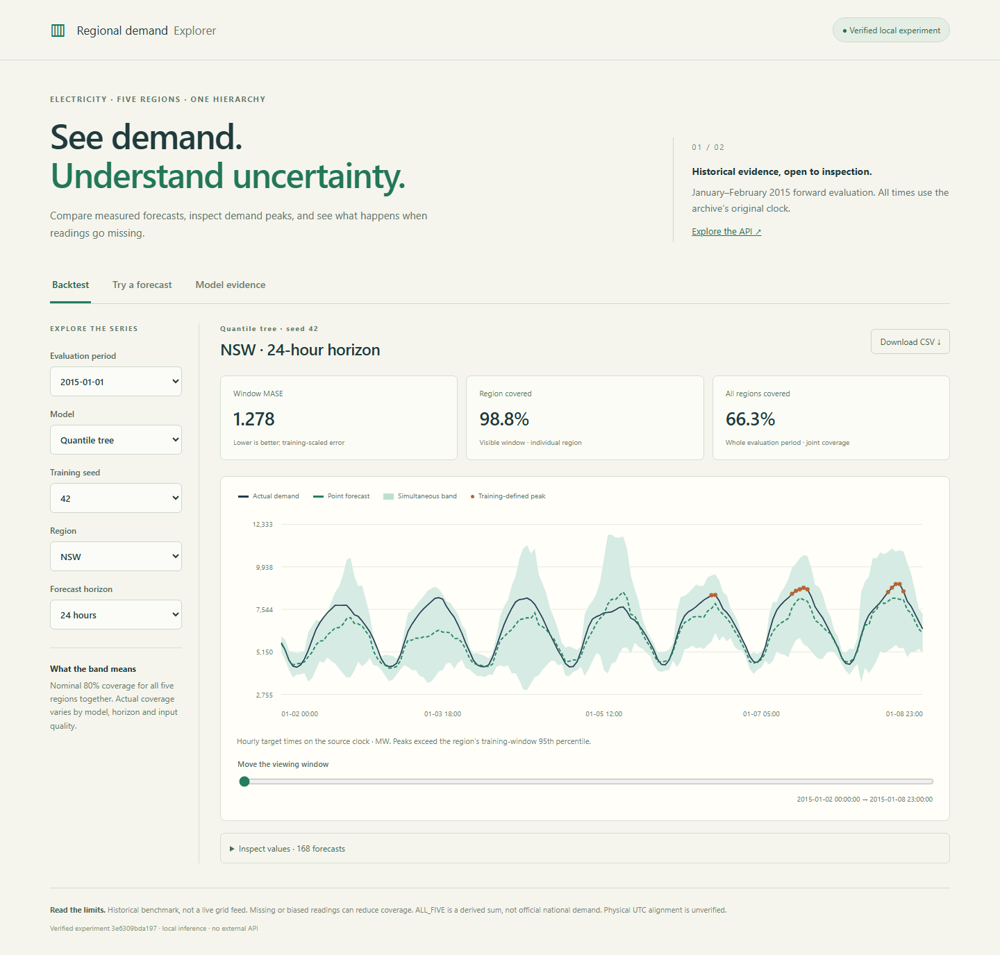

# Probabilistic grid forecasting

Explore hourly electricity demand forecasts for five Australian regional series
and their derived aggregate. Compare boosted trees and a temporal transformer,
inspect coherent prediction bands, and replay missing or biased observations.
Horizons are 1, 6, 24 and 168 hours.



## Run the explorer

Use Python 3.11 and Node.js 24 in a separate environment. No GPU, account or paid
service is required. On Windows, activate with `.venv\Scripts\Activate.ps1`.

```sh
python -m venv .venv
source .venv/bin/activate
python -m pip install torch==2.11.0 --index-url https://download.pytorch.org/whl/cpu
python -m pip install -r requirements/service.txt -r requirements/tracking.txt -e .
npm --prefix frontend ci
npm --prefix frontend run build
grid-pipeline --root runs/demo --device cpu
grid-serve --data runs/demo/data --experiment runs/demo/experiment
```

Open [localhost:8012](http://127.0.0.1:8012). The pipeline downloads approximately
38 MB of pinned data, trains both model families, evaluates them, checksums their
artifacts and records the run in local MLflow. Allow several minutes after package
installation; runtime depends on the machine. Models are trained locally from
scratch. The service checks their identity before accepting requests.

The [demo guide](docs/DEMO.md) explains the controls, custom-input API and recovery.
The [architecture](docs/ARCHITECTURE.md) describes the local pipeline and service.

## Measured results

January–February 2015 forward evaluation, with fixed settings from the earlier
2014 experiment. Models and calibration remain fixed within each 21-day test.

| Calibrated model | MASE ↓ | Joint regional coverage | Mean band width, MW |
| --- | ---: | ---: | ---: |
| Boosted trees | 0.879 | 72.6% | 2,239 |
| Transformer, three seeds | 1.202 | 88.7% | 4,328 |

Trees are more accurate but miss the nominal 80% joint-coverage target.
Transformer bands cover more often and are nearly twice as wide. Under a
24-hour reading outage, matched daily-origin coverage falls to 37.5% and 74.4%.
Repair keeps inference running; it does not preserve calibration.

The original seasonal/tree baseline and the matched-cutoff temporal comparison
remain available with every forecast, metric and model checksum:

- [Seasonal and tree baseline](results/baseline) · [evaluation protocol](docs/EVALUATION.md)
- [2014 temporal comparison](results/probabilistic) · [model and calibration method](docs/PROBABILISTIC.md)
- [Forward and stress evaluation](results/forward) · [experiment workflow](docs/EXPERIMENTS.md)
- [Service and reproduction checks](results/release) · [model card](docs/MODEL_CARD.md)

## Limits and data

This is a historical benchmark, not a live grid feed. Pinned `tsibbledata` files
provide `OperationalLessIndustrial` demand for NSW, QLD, SA, TAS and VIC.
`ALL_FIVE` sums those series; it is not official national demand. The original
day/period clock has no verified shared UTC alignment. No weather is used.
Simultaneous regional bands and aggregate envelopes are not marginal quantiles
or guarantees for future demand. See [data attribution](docs/DATA.md).

## Development

```sh
python -m pip install -r requirements/dev.txt
python -m pytest -q
cd frontend
npx playwright install chromium
npm test
```

Browser tests use an explicitly synthetic miniature experiment; release checks
also exercise the real trained models. CI runs the base suite, full CPU suite,
TypeScript build and browser tests. Source, frontend, tests, configs, dependency
pins and evidence are grouped in their respective folders.

Code and distributed derived results use [GPL-3.0-only](LICENSE).
