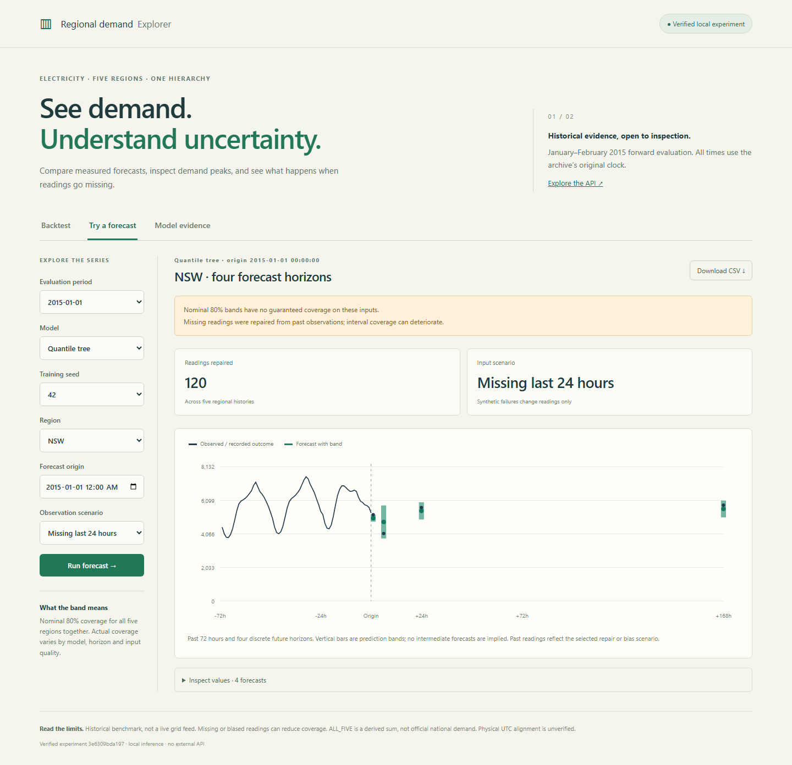

# Forecast explorer

Follow the [README setup](../README.md). Keep `grid-serve` running and open
[the local explorer](http://127.0.0.1:8012). Stop it with Ctrl+C. The interface
loads local assets only and needs no account.

## Screenshots

These captures use the real local service and the published forward experiment's
trained models. There is no public hosted instance; the local link above works
after setup on your own computer.


**Backtest:** January 2015 snapshot, tree model, seed 42, NSW, 24-hour horizon.
The visible week has 98.8% single-region coverage; 66.3% is the separate,
whole-period joint coverage for this snapshot and horizon.



**Missing readings:** the same model at origin January 1, 2015, with the last
24 hours withheld across five regions. The service repairs 120 readings and
shows four forecast horizons with an explicit coverage warning. This is an
observation-failure simulation on historical data, not a live grid outage.

## Explore

- **Backtest:** choose the January or February snapshot, model, seed, region and
  horizon. Move the seven-day window to inspect actuals, forecasts and bands.
  Orange points mark demand above the region's training-only 95th percentile.
  Window MASE and single-region coverage differ from whole-fold joint coverage.
  The table and CSV export expose the underlying rows.
- **Try a forecast:** choose an hourly source-clock origin and replay clean,
  missing or biased readings. Forecasts appear at the four supported horizons;
  there are no interpolated intermediate predictions. Known outcomes are shown
  separately and never enter model inputs. Missing-reading counts and warnings
  identify the applied repair.
- **Model evidence:** compare raw, reconciled and calibrated outputs, plus the
  matched daily-origin stress evaluation. Narrower bands are not necessarily
  better if they miss outcomes.

All times are naive source-clock labels, not browser-local or verified UTC times.
The January snapshot cannot predict before January 1; the February snapshot
cannot predict before February 1. Origins beyond the evaluated window produce
a warning. An older snapshot is a historical comparison, not a continuously
updated forecasting model.

## API

Interactive request documentation is at [localhost:8012/docs](http://127.0.0.1:8012/docs).
`GET /api/health` and `/api/meta` report the verified experiment version.
`GET /api/backtest` returns measured rows and scores; `/api/stress` returns the
stored observation-failure experiment.

Example `POST /api/forecast` body:

```json
{"fold":"2015-01-01","family":"tree","seed":42,"origin":"2015-01-10T00:00:00","scenario":"missing_24h"}
```

For observations outside the archive, supply `history`: exactly 337 consecutive
hourly rows ending at `origin`, each with five numbers ordered NSW, QLD, SA, TAS,
VIC. Readings are nonnegative MW, at most 1,000,000; JSON `null` represents a
missing value. Do not include the aggregate, future targets, or timezone offsets.
Custom history requires the `clean` scenario; the missing-data policy still
applies. Leading gaps and more than 24 consecutive missing hours per region are
rejected. Unknown fields, models, dates and seeds receive HTTP 422.

Responses include four horizons for all six nodes, coherent lower/point/upper
values, repaired-reading counts and warnings. Custom inputs never receive
archived actuals: matching a timestamp does not prove an observation is the
same real-world measurement. Supplying new history does not retrain or
recalibrate the snapshot.

The service binds to loopback, loads CPU models once, and serializes inference.
It has no authentication, rate limiting or public-hosting configuration. It is
intended for local use with trusted experiment files.

## Reproduce and recover

`grid-pipeline --root runs/demo --device cpu --resume` continues the identical
pipeline after an ordinary interruption. Completed runs are verified without
retraining or adding another tracking run. Configuration, source, package and
device changes require a new root. Use `grid-experiment verify` to inspect an
older sealed run without attempting to resume it under changed source.

A hard process termination may leave `runs/demo/pipeline.lock`. Confirm no
pipeline process is running before deleting that one lock file and resuming.
Do not modify dataset, model, calibration or result files inside a sealed run.
Checksum failures require restoration from the original run or reproduction
into a new directory.

On Windows, keep checkout and output paths short: MLflow's nested artifact
paths can exceed the platform's path limit. If pytest's default temporary
directory is inaccessible, pass `--basetemp` with a new, short directory under
an existing writable parent. Pytest owns and may clear that directory.

CPU and GPU training may choose different epochs and predictions even with
fixed seeds. The published forward results identify the GPU execution; the
release evidence separately records a complete CPU reproduction. Repeated
training on the same pinned device/software is the appropriate exactness test.

To audit real models through the API:

```sh
python scripts/verify_service.py --data runs/demo/data --experiment runs/demo/experiment --output runs/service-validation.json
```

For browser tests against your running real service, set `GRID_DEMO_URL` to
`http://127.0.0.1:8012` before `npm --prefix frontend test`. Otherwise tests create
a small synthetic experiment themselves. On Windows, `GRID_PYTHON` can select
the absolute path of the environment's `python.exe`.
